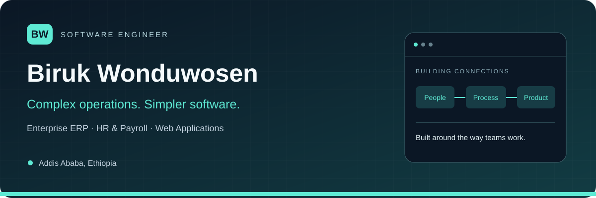

  

  <strong>Chief Software Developer at Federal Housing Corporation</strong> 
  Building enterprise applications, ERP systems, and useful digital services.

  
  
  

  <a href="#selected-work">Selected work</a> &nbsp; / &nbsp;
  <a href="#toolbox">Toolbox</a> &nbsp; / &nbsp;
  <a href="#experience">Experience</a> &nbsp; / &nbsp;
  <a href="#lets-build-something-useful">Contact</a>

---

## Software built around real work

Hi, I'm **Biruk Wonduwosen**, a full stack software engineer in **Addis Ababa, Ethiopia**. I turn business requirements into applications that help teams manage their daily operations.

My work connects the interface people use with the workflows, integrations, and data behind it.

<table>
<tr>
<td width="33%" valign="top">
<h3>01 · Enterprise systems</h3>

ERP development, property management, and service workflows shaped around business needs.

</td>
<td width="33%" valign="top">
<h3>02 · HR &amp; payroll</h3>

Employee processes, attendance integration, payroll configuration, permissions, and approvals.

</td>
<td width="33%" valign="top">
<h3>03 · Web products</h3>

Booking platforms, customer journeys, APIs, and improvements to existing applications.

</td>
</tr>
</table>

## Selected work

### 01 / My Clean & Cook
**Service booking marketplace · React + ASP.NET Core + SQL Server**

A cleaning and cooking platform bringing customer bookings, worker applications, availability, and admin assignment into one workflow.

- Service packages and booking requests.
- Worker onboarding and availability management.
- Rules-based worker matching and admin management.
- PayPal sandbox checkout integration.

**[Explore the website ↗](https://mycleancook.co.uk/)**

---

### 02 / Federal Housing Corporation ERP
**Enterprise operations · One-Stop Service Center · Property management**

ERP development supporting business operations at Federal Housing Corporation, including One-Stop Service Center and property management functionality.

**[Visit FHC ERP ↗](https://fhcerp.efhc.gov.et/)** · Authorized access may be required.

---

### 03 / FHC HR & Payroll
**Frappe Framework · ERPNext · Frappe HR / HRMS**

HR and payroll implementation covering employee records, attendance synchronization, leave, salary structures, and payroll processing.

- Employee-to-user and employee-to-payroll mappings.
- Role permissions and approval workflows.
- Custom scripts, reporting, troubleshooting, and handover.

**Related work:** Federal Housing Corporation ERP.

<strong>More enterprise project experience</strong>

 

- **Oromia Mineral Management System:** Development experience with mineral management software.
- **Land Development & Management System:** Development experience with enterprise land management workflows.

Private source code and client records are not included in this profile.

## Toolbox

**Interfaces**

**APIs & business logic**

**ERP & data**

**Also work with:** JavaScript, HTML, CSS, PHP, Entity Framework Core, Git, Linux, Bench CLI, IIS, and Plesk.  
**Ways of working:** Requirements analysis, Agile, Scrum, stakeholder collaboration, and troubleshooting.

## Experience

**Chief Software Developer** · Federal Housing Corporation  
**May 2022–Present**

Enterprise application and ERP development, property management, service workflows, and HR and payroll implementation.

**Full Stack Developer** · Xoka IT Solution PLC  
**May 2021–May 2022**

Full stack development and collaboration on business applications.

<strong>Education</strong>

 

- **Master's in Computer Science, Software Engineering** · Addis Ababa University · August 2024
- **BSc in Information Systems** · Hope Enterprise University College · August 2021

---

## Let's build something useful

Need a web application, an ERP customization, or help improving an existing system? Tell me what your team needs to do.

**Email:** [bwondu1@gmail.com](mailto:bwondu1@gmail.com) · **WhatsApp:** [+251 93 848 7879](https://wa.me/251938487879) · **Telegram:** [@birukwn](https://t.me/birukwn)

Biruk Wonduwosen · Enterprise software. Practical solutions.

